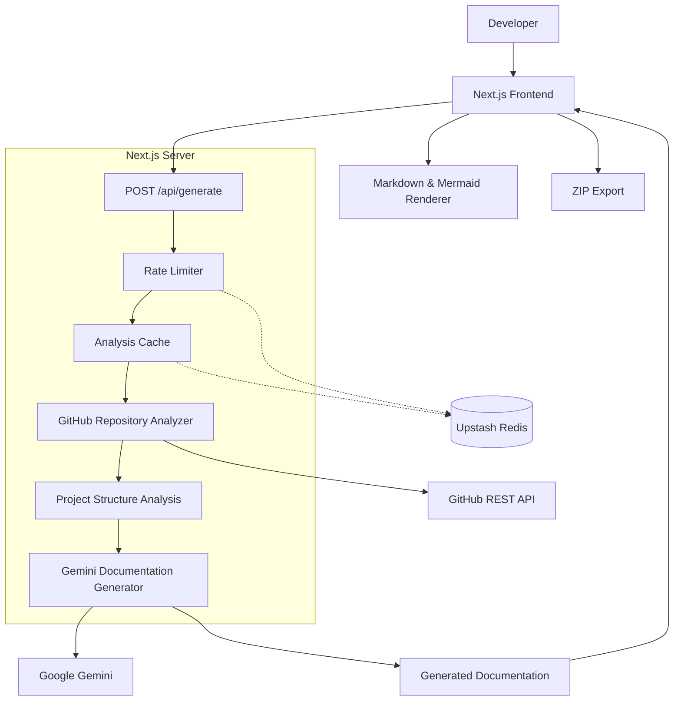

# 🚀 CodeDocs — AI-Powered Documentation Generator

**Turn any public GitHub repository into clear, structured, developer-friendly documentation with AI.**

CodeDocs (`autodoc-ai`) is an AI-powered documentation engine that analyzes public GitHub repositories and automatically generates high-quality `README.md` and `FILE_MAP.md` files using Google Gemini.

Instead of manually exploring folders, identifying dependencies, and writing documentation, simply provide a GitHub repository URL and let CodeDocs do the work.

<p align="center">
  
  
  
  
</p>

---

## ✨ Why CodeDocs?

Understanding an unfamiliar codebase can be time-consuming. CodeDocs simplifies that process by combining GitHub repository analysis with generative AI.

- **⚡ Faster Documentation:** Generate documentation without writing everything manually.
- **🔍 Repository Insights:** Explore project structure, dependencies, frameworks, and entry points.
- **🤖 AI-Powered Generation:** Use Google Gemini to synthesize documentation tailored to the repository.
- **📊 Architecture Visualization:** Render Mermaid diagrams directly in the generated documentation.
- **📦 One-Click Export:** Download generated documentation as a ZIP archive.
- **🚦 Reliable API Handling:** Handle invalid URLs, private repositories, oversized projects, rate limits, and provider errors.
- **♻️ Smart Caching:** Reuse cached analyses through Upstash Redis to reduce repeated work.

## 🛠️ Features

| Feature | Description |
|---|---|
| GitHub Integration | Inspects public repositories using the GitHub REST API and Octokit. |
| Project Analysis | Identifies directory structures, manifest files, dependencies, and likely entry points. |
| README Generation | Creates structured project documentation with Google Gemini. |
| File Mapping | Generates `FILE_MAP.md` to explain the purpose and organization of project files. |
| Markdown Rendering | Supports GitHub Flavored Markdown, syntax highlighting, and formatted content. |
| Mermaid Diagrams | Renders architecture diagrams and other supported Mermaid visualizations. |
| ZIP Export | Packages generated documentation for convenient downloading. |
| Rate Limiting | Helps control API usage through Redis-backed rate limiting. |
| Analysis Caching | Stores reusable analysis results using Upstash Redis. |
| Typed Error Handling | Uses defined error codes to support clearer API responses and debugging. |

## 🧰 Tech Stack

| Layer | Technologies |
|---|---|
| Frontend & Framework | Next.js 16, React 19 |
| Language | TypeScript 5, Node.js |
| Styling & Icons | Tailwind CSS v4, Lucide React |
| AI Integration | Vercel AI SDK, `@ai-sdk/google`, Google Gemini |
| GitHub API | `@octokit/rest` |
| Cache & Rate Limiting | Upstash Redis, `@upstash/redis` |
| Markdown & Diagrams | `react-markdown`, `remark-gfm`, `rehype-highlight`, Mermaid |
| Export & Validation | JSZip, Zod |
| Code Quality | ESLint 9, `eslint-config-next` |

## 🏗️ Architecture

CodeDocs follows a Next.js App Router architecture. The frontend sends a request to the backend API, which coordinates repository analysis, caching, rate limiting, and AI-powered document generation.



### How It Works

1. **Submit a repository:** Provide the URL of a public GitHub repository.
2. **Inspect the codebase:** CodeDocs retrieves repository information and analyzes its structure.
3. **Identify the technology stack:** It examines manifests, dependencies, and potential entry points.
4. **Generate documentation:** Google Gemini synthesizes a project README and file map.
5. **Review the results:** Explore the generated Markdown and supported architecture diagrams.
6. **Export your files:** Download the generated documentation as a ZIP archive.

## 🚀 Getting Started

Follow these steps to run CodeDocs locally.

### Prerequisites

Make sure you have the following installed:

- [Node.js](https://nodejs.org/) 20 or later
- npm, pnpm, yarn, or bun
- A Google AI API key
- An Upstash Redis database for the configured caching and rate-limiting functionality
- A GitHub personal access token (optional for public repositories, depending on API usage)

### 1. Clone the Repository

```bash
git clone https://github.com/RutikKamble01/CodeDocs.git
cd CodeDocs
```

### 2. Install Dependencies

Using npm:

```bash
npm install
```

### 3. Configure Environment Variables

Create a `.env.local` file in the project root, alongside `package.json`.

Add the credentials required by your project:

```env
# Google Gemini API
GOOGLE_GENERATIVE_AI_API_KEY=your_google_api_key

# GitHub API (optional for public repositories)
GITHUB_TOKEN=your_github_token

# Upstash Redis
UPSTASH_REDIS_REST_URL=https://your-instance.upstash.io
UPSTASH_REDIS_REST_TOKEN=your_upstash_token
```

**Important:** Confirm the exact environment variable names in your project's `lib/ai.ts`, `lib/github.ts`, `lib/cache.ts`, and `lib/ratelimit.ts` files before running the application. The names above reflect the intended configuration and should be verified against the implementation.

Keep your `.env.local` file private. Never commit API keys or access tokens to GitHub.

### 4. Start the Development Server

```bash
npm run dev
```

Open [http://localhost:3000](http://localhost:3000) in your browser.

You can now test the application locally.

## 📜 Available Commands

| Command | Purpose |
|---|---|
| `npm run dev` | Start the local development server. |
| `npm run lint` | Check the codebase for linting issues. |
| `npm run build` | Create a production build. |
| `npm run start` | Start the production server after building. |

## ⚠️ Error Handling

CodeDocs defines error codes to help identify common failures.

| Error Code | Meaning |
|---|---|
| `INVALID_URL` | The supplied repository URL is invalid. |
| `NOT_FOUND` | The repository could not be found. |
| `PRIVATE_REPOSITORY` | The repository is private or inaccessible. |
| `EMPTY_REPOSITORY` | The repository contains no usable content to analyze. |
| `RATE_LIMITED` | An API or application rate limit has been reached. |
| `TOO_LARGE` | The repository exceeds the application's supported size limits. |
| `PROVIDER_ERROR` | The AI provider or an external service returned an error. |
| `UNKNOWN` | An unexpected error occurred. |

The precise conditions associated with each code depend on the API implementation.

## 🔐 Security & Configuration

- Store credentials in environment variables, not in source code.
- Keep `.env.local` out of version control.
- Use the minimum GitHub token permissions necessary for your application.
- Configure rate limits to protect external API quotas.
- Avoid logging API keys, access tokens, or other sensitive information.

## 🗺️ Future Improvements

Potential enhancements for future releases include:

- Support for additional AI providers.
- More detailed dependency and architecture analysis.
- Documentation regeneration when repository changes are detected.
- Downloadable architecture reports and additional export formats.
- Improved handling of large repositories and monorepos.
- Automated documentation quality checks.

These are possible future enhancements, not claims about currently implemented features.

## 🤝 Contributing

Contributions, bug reports, and feature suggestions are welcome.

1. Fork the repository.
2. Create a feature branch.
3. Implement and test your changes.
4. Submit a pull request with a clear description of your changes.

Please ensure that linting and production builds pass before submitting changes.

## 👨‍💻 Author

**Rutik S. Kamble**

GitHub: [@RutikKamble01](https://github.com/RutikKamble01)

Project: [CodeDocs](https://github.com/RutikKamble01/CodeDocs)

---

<p align="center">
  <strong>Less time writing documentation. More time building software. 🚀</strong>
</p>
